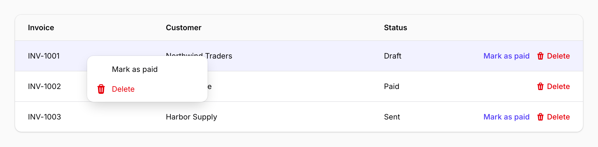
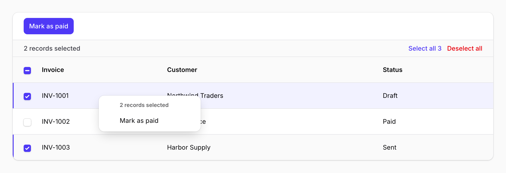
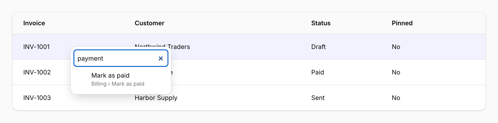
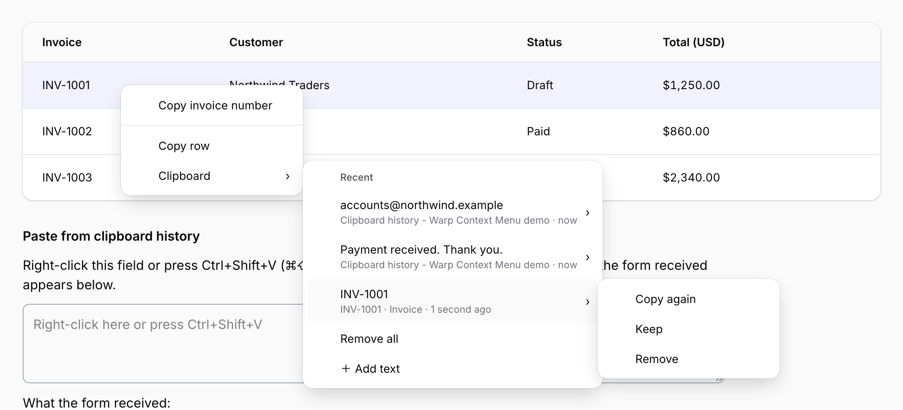

# Warp Context Menu

Right-click a Filament table row, cell, selection or page to use native Filament actions, search them, and collect text in a reusable clipboard.

<a href="https://demo.warpui.com/contextmenu"></a>

**Free and open source (MIT).**



- [Features](#features)
- [Installation](#installation)
- [Usage](#usage)
- [Clipboard](#clipboard)
- [Keyboard](#keyboard)
- [Touch](#touch)
- [Accessibility](#accessibility)
- [Security](#security)
- [Translations](#translations)
- [Testing](#testing)
- [AI coding assistants (Laravel Boost)](#ai-coding-assistants-laravel-boost)
- [Requirements](#requirements)
- [Support](#support)
- [License](#license)
- [More from Warp](#more-from-warp)

## Features

- **Actions evaluated per row.** Labels, icons, colors, badges, visibility, authorization and disabled states follow the clicked record.
- **Keep your existing actions.** One `->contextMenu()` reuses `recordActions()`. Forms, confirmation dialogs, notifications and redirects still belong to Filament.
- **Submenus and sections.** Use ordinary `ActionGroup` objects, or an explicit separator.
- **Bulk actions.** Right-click selected rows to use the toolbar's bulk actions, including Filament's all-pages selection.
- **Cell and page menus.** Add actions to any table column; reuse a page's header actions and navigation across page chrome without a trait.
- **Links and copying.** Copy cell text, a row as tab-separated columns, a link address, or a value provided by an action. Open underlying links in a new tab.
- **Search.** Type to filter, including actions inside submenus, with paths in the results and optional extra keywords.
- **Clipboard history and kept text.** Collect copies in the panel, save reusable templates and paste into form fields.
- **Keyboard and touch.** ContextMenu key, Shift+F10, arrow navigation, visible shortcuts, and long press. Phone menus use a bottom sheet with Back navigation.
- **Light and dark mode, RTL and ten languages.** Uses Filament's colors and icons.
- **Tenant-aware lookup.** Records are resolved again through the table query; hidden or unauthorized action names and labels are not sent to the browser.

## Installation

Requires **Filament 5.9.0 or later** and PHP 8.3 or later.

```bash
composer require qalainau/filament-warp-contextmenu
php artisan filament:assets
```

Register the plugin in each panel provider:

```php
use Filament\Panel;
use Qalainau\FilamentWarpContextMenu\WarpContextMenuPlugin;

public function panel(Panel $panel): Panel
{
    return $panel
        ->id('admin')
        ->path('admin')
        ->plugin(WarpContextMenuPlugin::make());
}
```

No migration, custom column class or Livewire trait is required. After updating the package, run `php artisan filament:assets` again.

## Usage

### Row actions

In your resource's `table()` method, reuse the actions already displayed on each row:

```php
use Filament\Actions\DeleteAction;
use Filament\Actions\EditAction;
use Filament\Tables\Columns\TextColumn;
use Filament\Tables\Table;

public static function table(Table $table): Table
{
    return $table
        ->columns([TextColumn::make('number')])
        ->recordActions([EditAction::make(), DeleteAction::make()])
        ->contextMenu();
}
```

Or define a menu of its own. Actions passed to `contextMenu()` are registered with Filament without adding buttons to the row's action column:

```php
use App\Models\Invoice;
use Filament\Actions\Action;
use Filament\Actions\ActionGroup;
use Filament\Actions\DeleteAction;
use Filament\Actions\EditAction;
use Filament\Tables\Table;
use Qalainau\FilamentWarpContextMenu\ContextMenu;

public static function table(Table $table): Table
{
    return $table->contextMenu([
        EditAction::make()->keyBindings(['mod+e']),
        ActionGroup::make([
            Action::make('markPaid')
                ->label('Paid')
                ->contextMenuKeywords(['payment', '入金'])
                ->contextMenuChecked(fn (Invoice $record): bool => $record->status === 'paid')
                ->disabled(fn (Invoice $record): bool => (float) $record->total === 0.0)
                ->tooltip('An invoice with no total cannot be paid')
                ->action(fn (Invoice $record) => $record->update(['status' => 'paid'])),
        ])->label('Status')->icon('heroicon-o-flag'),
        ActionGroup::make([
            Action::make('printInvoice')
                ->label('Print')
                ->url(fn (Invoice $record): string => route('invoices.print', $record))
                ->openUrlInNewTab(),
        ])->label('Share')->dropdown(false),
        ContextMenu::separator(),
        DeleteAction::make(),
    ]);
}
```

The `invoices.print` route in this example is an application route you provide. An action with `url()` follows its link, respecting `openUrlInNewTab()`, rather than mounting an action. Other actions mount through Filament, so your form, confirmation and authorization behave as they do for a normal action button. Disabled actions remain visible, cannot run, and show their `tooltip()` as the reason.

| Method | Arguments | Behavior |
| --- | --- | --- |
| `Table::contextMenu()` | `array\|Closure\|null $actions = null` | `null` reuses `recordActions()`; an array or closure supplies a separate menu. `[]` supplies no row actions. |
| `ContextMenu::separator()` | None | A divider. Leading, trailing and consecutive dividers are removed. |
| `Action::contextMenuChecked()` | `bool\|Closure $condition = true` | A checkable menu item with the evaluated state. |
| `Action::contextMenuKeywords()` | `array\|Closure $keywords` | Additional search terms. |
| `Action::contextMenuCopy()` | `Closure $value` | Copy an evaluated string instead of mounting the action. |

`ActionGroup` with its default dropdown becomes a submenu. `dropdown(false)` becomes a labeled section. Empty groups are removed.

Action names must be unique across the row and cell menus. They must also not conflict with a different action registered on the table. For example, `Action::make('send')` in both the row menu and an email column's menu throws a `LogicException`; call the cell action `emailCustomer` instead. To reuse a registered action, use the same action object or the no-argument `contextMenu()`.

### Selected records



```php
use Filament\Actions\BulkAction;
use Filament\Tables\Table;
use Illuminate\Database\Eloquent\Collection;

public static function table(Table $table): Table
{
    return $table
        ->toolbarActions([
            BulkAction::make('markSent')
                ->label('Mark as sent')
                ->requiresConfirmation()
                ->action(fn (Collection $records) => $records->each->update(['status' => 'sent']))
                ->deselectRecordsAfterCompletion(),
        ])
        ->contextMenu()
        ->contextMenuBulkActions();
}
```

| Method | Arguments | Behavior |
| --- | --- | --- |
| `Table::contextMenuBulkActions()` | `array\|Closure\|null $actions = null` | Reuses toolbar bulk actions by default; accepts a separate list of `BulkAction` objects and groups. |

Right-click a selected row when at least two records are selected to open the bulk menu, with a selected-count heading. Right-click an unselected row to open its own menu without changing the selection. Filament's all-pages selection is preserved. Bulk visibility and authorization do not depend on a single clicked record.

### Cell actions

```php
use App\Models\Invoice;
use Filament\Actions\Action;
use Filament\Tables\Columns\TextColumn;

TextColumn::make('customer.email')
    ->label('Email')
    ->contextMenu([
        Action::make('emailCustomer')
            ->label('Email customer')
            ->url(fn (Invoice $record): string => 'mailto:'.$record->customer->email),
    ]);
```

`Column::contextMenu(array|Closure $actions)` works on ordinary Filament table columns. Cell actions are placed before the row actions and receive the row's record. Hidden and toggled-off columns do not contribute cell menus.

### Column headers and table space

Configured tables enable two additional menus by default. Right-click a column header to sort ascending or descending, clear sorting, hide a toggleable column, or copy that column’s visible values with newlines. Sorting shows the current direction. Hidden columns never enter the capability payload.

Right-click table space, the toolbar or pagination to use `headerActions()`, select this page’s selectable rows, deselect all, reset filters, reload the table or copy visible columns and rows as TSV with a header row. Selection commands appear only on selectable tables; filter reset appears only when filters exist. These commands use Filament’s native sorting, column manager, selection and filter APIs.

```php
$table->contextMenu()->contextMenuHeaders(false); // Disable column-header menus.
$table->contextMenu()->contextMenuTable(false);   // Disable table-space menus.
```

The two boolean settings default to true. Table surfaces never fall back to the page menu, including when opted out.

### Page actions

Registering `WarpContextMenuPlugin::make()` enables page menus by default, everywhere outside tables: headers, form labels, infolists, widgets, sidebars, topbars and empty space. Disable with `WarpContextMenuPlugin::make()->pages(false)`.

Menus include the page’s visible, authorized header actions, Copy link to this page, Reload page, Back, Forward, Copy selected text when text is selected, and the Clipboard submenu when `clipboard()` is enabled. Back uses the same translated label as a sheet’s submenu navigation. Inputs keep their native menu or the clipboard paste picker.

For a separate action list, define this method on the page (no trait):

```php
public function getContextMenuActions(): array
{
    return [Action::make('help')->url('https://example.com/help')];
}
```

### Infolist entries

Entries offer Copy value by default, followed by page commands. Add native entry actions with `Entry::contextMenu(array|Closure)` or disable copying for one entry:

```php
use Filament\Infolists\Components\TextEntry;

TextEntry::make('email')->contextMenu([
    Action::make('emailCustomer')->url(fn ($record) => 'mailto:'.$record->email),
]);
TextEntry::make('private_note')->contextMenuCopyValue(false);
```

Entry actions use Filament’s schema action context and normal visibility and authorization checks. Hidden entries and entries inside hidden parents return no menu payload. `pages(false)` also disables entry menus.

### Links and copying

On a table cell, **Copy cell text** is available by default. On an underlying link, **Open link in new tab** and **Copy link address** are added in their own section after the copying actions.

```php
$table->contextMenuCopyCell(false); // bool $condition = true
$table->contextMenuLinks(false);    // bool $condition = true
```

For a value that differs from the displayed text:

```php
use App\Models\Invoice;
use Filament\Actions\Action;

Action::make('copyNumber')
    ->label('Copy invoice number')
    ->contextMenuCopy(fn (Invoice $record): string => $record->number);
```

These copies also write to the operating system clipboard. A clipboard permission failure is announced. With clipboard history enabled, **Copy row** joins the visible data cells with tabs, so you can paste into a spreadsheet; selection and action cells are omitted.

### Search



Start typing in an open menu to search. Menus containing at least eight leaf actions show the search field immediately. Matching ignores case and accents, searches inside submenus and includes `contextMenuKeywords()`. Results are flattened and show the submenu path. Disabled actions remain searchable with their reason. An unmatched query shows an empty message. Enter runs the first result; arrows choose another. Escape clears a search first, then closes the menu.

### Browser menu and empty menus

Shift + right-click always leaves the browser's menu available. Input, textarea, select and editable content keep their native menus. Selected text keeps its native menu on tables; page menus offer Copy selected text. Clipboard-enabled text inputs are the exception described below. A row with no available actions or enabled conveniences falls back to the browser menu once its empty payload is known. On the first asynchronous lookup an empty result dismisses the loading menu; use Shift + right-click to explicitly open the browser menu.

Menus for up to **100 record keys** are prefetched in one request when the pointer enters the table. Further keys are truncated on the server. A Livewire update invalidates the cached menus. Hidden and unauthorized actions, including their names and labels, are omitted from the payload.

## Clipboard



Clipboard history is opt-in:

```php
use Qalainau\FilamentWarpContextMenu\WarpContextMenuPlugin;

$panel->plugin(WarpContextMenuPlugin::make()->clipboard());

// Or keep saved text only for the lifetime of the browser tab too:
$panel->plugin(WarpContextMenuPlugin::make()->clipboard(limit: 10, persist: false));
```

| Argument | Default | Behavior |
| --- | --- | --- |
| `bool $enabled` | `true` | Enable or disable clipboard capture and pickers. |
| `int $limit` | `10` | Maximum recent values; negative limits become zero. Kept values do not count. |
| `bool $persist` | `true` | Saved text uses `localStorage`; `false` keeps it in `sessionStorage`. Recent copies always use `sessionStorage`. |

Disable **Copy row** and **Clipboard ›** for one table's row and cell menus while keeping panel copy capture and input paste enabled:

```php
$table->contextMenuClipboard(false); // bool $condition = true
```

Calling `contextMenuClipboard()` restores these menu entries when the panel's `clipboard()` is enabled. Cell copy and link actions keep their own settings.

Copies inside the panel enter history: Ctrl+C / ⌘C, the browser's Copy command, Filament `copyable()` fields using `navigator.clipboard.writeText`, and this plugin's cell, row, link and custom copy actions. Capturing the native copy event and wrapping clipboard writes does not read the operating system clipboard. Copies from Excel, email or another app cannot be collected automatically: browsers require explicit user permission and interaction to read that clipboard.

History stores the text, its source when known (for example, an invoice number and column label; otherwise the page title), and its copy time. Source and localized relative time appear below the value. Copying the same value moves it to the top. Whitespace-only values and entries longer than 5,000 characters are ignored. Older recent copies fall out after ten values by default. **Keep** saves an item until you stop keeping or remove it; kept items appear first and do not consume the recent limit. **Remove all except kept items** clears only the recent values.

Choose **＋ Add text** to type a multiline value and an optional name. **Save** is disabled while the text is empty or whitespace. **Cancel** or Escape returns to the list. Named kept items show the name in bold and a one-line preview of the text. You can edit the name and value or remove the item. Searching a clipboard list matches both the name and text.

There are three ways in:

1. Right-click an editable text input or textarea to pick a value and paste it. Empty history keeps the browser menu. Shift + right-click always opens that menu.
2. Press Ctrl+Shift+V (⌘⇧V on Mac) in a text input to open the picker near the caret, including when history is empty so you can add text.
3. Open **Clipboard ›** in a row, cell or page menu to copy a value again, keep it, edit kept text, or remove values.

Pasting replaces the selected range or inserts at the caret and dispatches an `input` event for Livewire and Alpine. Disabled and read-only fields do not offer paste. Password fields do not capture copies or offer a picker, including Filament revealable password fields while revealed (identified by bindings such as `x-bind:type` or `:type` containing `password`). Fields with `autocomplete="one-time-code"`, `"new-password"` or `"current-password"` are also excluded.

Add `data-warp-no-clipboard` to an element or a containing region to exclude sensitive copies and the input picker:

```html
<div data-warp-no-clipboard>
    <input type="text" name="private_reference">
</div>
```

Native copies check the event target and focused element; programmatic `navigator.clipboard.writeText()` calls check the element focused when the call starts. These exclusions prevent history capture without preventing the system clipboard write.

Values stay in the browser and are never sent to the server by the clipboard feature. **Recent** copies always use `sessionStorage` and disappear when the tab closes. Only values explicitly saved with **Keep** or **＋ Add text** use `localStorage` by default. Logging out preserves this intentionally saved text: the same user can access it after logging in again. Choose `persist: false` to keep saved text in `sessionStorage` too, so closing the tab removes both lists.

Storage keys hash the panel, signed-in user and current tenant. Another user's or tenant's bucket is not read. Capture and pickers are disabled without a current panel or signed-in user. Browser storage is not encrypted, and standard browser storage restrictions can prevent saving history.

## Keyboard

| Key | Action |
| --- | --- |
| ContextMenu or Shift+F10 | Open for the focused row, or the last row under the pointer. |
| Type text | Search the open menu, including submenu actions. |
| ↑ / ↓ | Move through items (disabled items remain focusable so their reason can be read). |
| Home / End | First / last item. |
| → / ← | Open / leave a submenu; reversed in RTL. |
| Enter / Space | Activate the focused item; Enter in search runs the first result. |
| Escape | Leave a submenu, cancel the editor, clear a search, or close and restore focus. |
| Tab | Close the menu; in the text editor, move between its fields and buttons. |
| Ctrl+Shift+V / ⌘⇧V | Open clipboard history in a supported input. |
| Shift + right-click | Open the browser menu. |

Filament `keyBindings()` are displayed alongside their actions, using Mac or Ctrl notation as appropriate.

## Touch

Hold a row for 500ms to open its menu. Moving more than 10px or scrolling cancels the hold. Below 640px the menu becomes a full-width bottom sheet with larger touch targets. Opening a submenu replaces the current level inside the sheet; **‹ Back** returns to the parent. Search and clipboard lists remain inside the sheet. Menus close on outside interaction, outside scrolling, resizing or navigation.

## Accessibility

Menus use WAI-ARIA `menu`, `menuitem`, `menuitemcheckbox`, `separator` and `group` roles. Submenu triggers expose `aria-haspopup` and `aria-expanded`; disabled and checked states use `aria-disabled` and `aria-checked`. Search and editor fields have labels. Copy feedback uses a `status` live region. Keyboard navigation restores the original focus when the menu closes. Reduced-motion preferences disable the opening animation.

## Security

Record keys received from the browser are looked up again through Filament's table query. A deleted record or a record outside the current tenant returns no actions. Only the first `__warpContextMenu` call in each Livewire request is evaluated; subsequent calls return an empty array. The request accepts at most 100 keys; sending extra keys does not bypass query scoping. Keep your resource query and policies configured as you would for ordinary table actions.

Visibility and authorization are evaluated before serialization. Hidden and unauthorized action names and labels are not disclosed. Clicking an executable action goes through Filament's normal mounting and authorization checks; a menu payload is not permission to run an action. Custom copy actions also respect a model's `view` policy when it defines one. `contextMenuCopy()` values are prefetched to the browser of anyone allowed to view the row as soon as the pointer enters it; do not use this API for secrets.

Labels, tooltips, clipboard text and search paths are rendered as text. Only icons generated by Filament are inserted as SVG markup. Do not pass user-supplied data to `icon()`. Navigation filters unsafe URL schemes. Clipboard history itself is browser storage, not encrypted storage; the clipboard feature does not send it to the server.

## Translations

English, Japanese, German, French, Spanish, Italian, Brazilian Portuguese, Korean, simplified Chinese and traditional Chinese are included. The menu follows the application's locale; relative clipboard times use `Intl.RelativeTimeFormat` in that locale. Labels you write in your own actions remain yours to translate.

```bash
php artisan vendor:publish --tag=filament-warp-contextmenu-translations
```

Overrides go to `lang/vendor/warp-contextmenu`. The translation namespace is `warp-contextmenu::contextmenu`.

## Testing

Ask your own table's Livewire component for a menu and inspect the returned payload. Set the authenticated user and current panel as in your other resource tests:

```php
use App\Filament\Resources\Invoices\Pages\ListInvoices;
use App\Models\Invoice;
use App\Models\User;
use Filament\Facades\Filament;
use Livewire\Livewire;

it('includes a copy action for the invoice', function () {
    $this->actingAs(User::factory()->create());
    Filament::setCurrentPanel(Filament::getPanel('admin'));
    $invoice = Invoice::factory()->create();
    $key = (string) $invoice->getKey();

    Livewire::test(ListInvoices::class)
        ->call('__warpContextMenu', [$key], 'record')
        ->assertReturned(function (array $payload) use ($key, $invoice): bool {
            $action = collect($payload[$key]['items'])->firstWhere('name', 'copyNumber');

            return $action['copyValue'] === $invoice->number;
        });
});
```

This example assumes the `copyNumber` action from “Links and copying” and application factories. Row payloads are keyed by record key and contain `items` and `cells` (keyed by column name). Each item contains its evaluated label, name, disabled state, URL and other display properties; groups contain `items`. Request `'bulk'` or `'page'` with `[]` for those menu payloads. For tenancy tests, set `Filament::setTenant($team, isQuiet: true)` before requesting and assert that another team's key returns empty `items` and `cells`.

## AI coding assistants (Laravel Boost)

Warp Context Menu ships instructions for AI coding assistants such as Claude Code, Cursor and Codex. If your app uses [Laravel Boost](https://laravel.com/docs/boost), the assistant learns to reuse Filament actions, configure search and clipboard history, and test menu payloads.

- **Guidelines** (`resources/boost/guidelines/core.md`): a short summary Boost adds to `CLAUDE.md`, `AGENTS.md` and other agent files. It points to this README in `vendor/`, so assistants read the documentation of the installed version.
- **Skill** `warp-contextmenu-development` (`resources/boost/skills/`): examples for each area and tests, loaded when the assistant works on Context Menu.

When `php artisan boost:install` asks "Which third-party AI guidelines/skills would you like to install?", select `qalainau/filament-warp-contextmenu`. To do it without the question, add the package to `boost.json` and run the command again:

```json
{
    "packages": ["qalainau/filament-warp-contextmenu"]
}
```

```bash
php artisan boost:install --guidelines --skills -n
```

## Requirements

- PHP 8.3 or later
- Laravel 12 or 13
- Filament 5.9.0 or later
- Filament's standard JavaScript and CSS assets

### Tested on

Release test records, including the PHP, Laravel and database combinations actually run, are published with the documentation. [See the results for each release](https://github.com/qalainau-labs/filament-warp-contextmenu-docs/tree/main/test-runs). See [`test-runs/`](test-runs/) when reading the published documentation. This plugin adds no database tables.

## Static analysis (PHPStan / Larastan)

The plugin ships a PHPStan extension for its Filament macros. With `phpstan/extension-installer`, it loads automatically. Otherwise add it to your PHPStan configuration alongside Larastan:

```neon
includes:
    - vendor/qalainau/filament-warp-contextmenu/extension.neon
```

## Support

Questions and bug reports: [warpui.com/support](https://warpui.com/support?plugin=contextmenu).

## License

Warp Context Menu is free and open source under the MIT license. See [LICENSE.md](LICENSE.md).

## More from Warp

- [Warp Sheet](https://warpui.com/plugins/sheet) — Work with tabular data in a spreadsheet interface.
- [Warp Tree](https://warpui.com/plugins/tree) — Organize and browse hierarchical records.
- [Warp Scheduler](https://warpui.com/plugins/scheduler) — Plan work on a calendar and timeline.
- [Warp Quick Look](https://warpui.com/plugins/quicklook) — Preview related records without leaving the page.
- [Warp Split View](https://warpui.com/plugins/splitview) — Keep a list and record details side by side.
